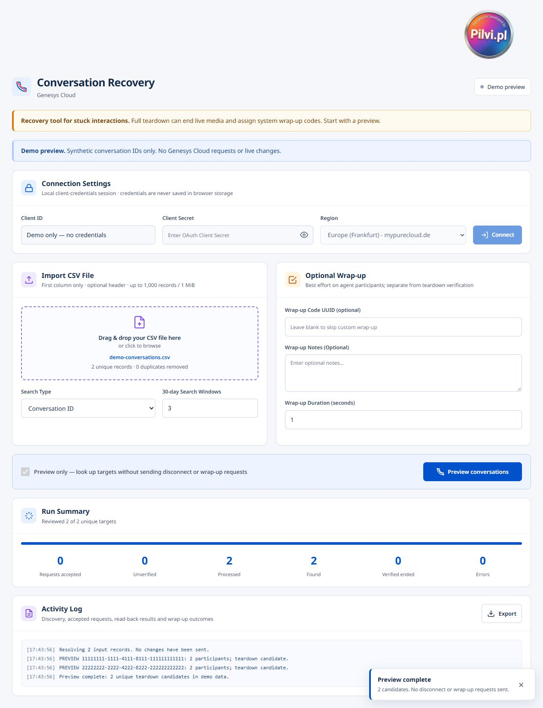
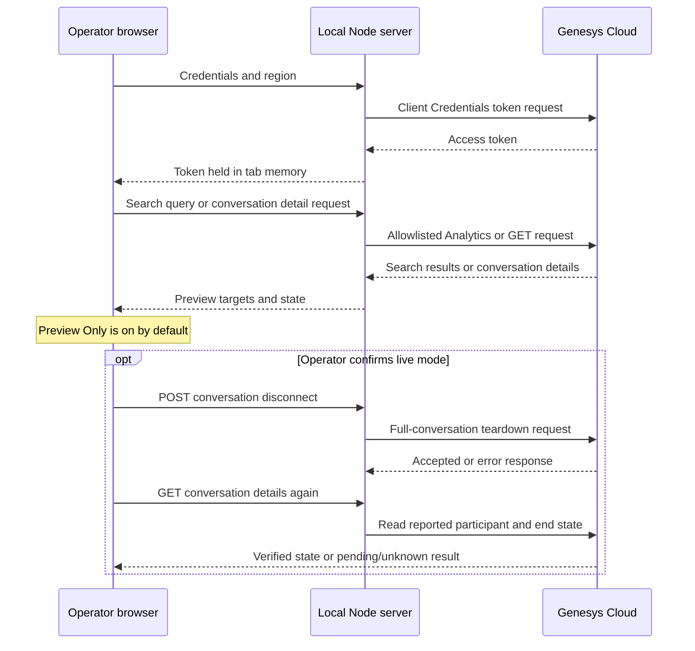

# Genesys Cloud Conversation Disconnector

A local, single-user tool for finding Genesys Cloud conversations from a CSV and requesting their disconnection. It uses a small Node.js server to exchange Client Credentials and proxy a limited set of Genesys Cloud API calls.

**A successful disconnect response does not prove that a call physically ended.** The tool reads conversation details before and after the request and reports verification only when Genesys returns a completed state. A pending or unknown state stays unverified.

## Preview



*Demo mode uses synthetic IDs and local fixtures. This image is not evidence of a live Genesys operation.*

Open `http://127.0.0.1:3000/?demo=1` to view the read-only demo. Demo mode makes no Genesys requests.

## What it does

- Read identifiers from the first column of a CSV file, remove duplicates, and skip a recognized optional header.
- Look up conversation UUIDs directly, or search active conversation details by exact `externalTag` match for a Case ID.
- Preview matching conversations and their current details before any disconnect request.
- In live mode, request conversation teardown, read the result, and report verified, pending, or failed outcomes separately.
- Optionally apply a wrap-up code, notes, and duration to agent participants on a best-effort basis.
- Stop processing after the current request finishes.

## Safety and operating limits

| Area | Behavior |
| --- | --- |
| Intended use | One local operator on one machine; the server binds to `127.0.0.1` by default |
| Preview | **Preview Only** is on by default. It can search and read conversation details, but does not send the conversation disconnect request or wrap-up PATCH |
| Live mode | Requires an explicit confirmation showing the number of targets and the Genesys region |
| Stop | Stops scheduling new disconnect or wrap-up requests; a final read-back may follow an in-flight teardown. Accepted changes cannot be undone |
| Disconnect | Uses the full-conversation disconnect endpoint, which tears down the conversation; it is an emergency/teardown action, not a routine participant update |
| Verification | Reads details before and after disconnect. Verified means every returned participant has an end time, a disconnected/terminated state, or only returned media in those terminal states. Unknown state remains unverified |
| Physical call state | Genesys API state cannot prove that a carrier or physical telephone connection has ended |
| Wrap-up | Optional and best effort; applied only to agent participants that were not already ended in the preview, never ACD participants. A failure is logged separately and does not erase an accepted disconnect. Teardown may already apply a system wrap-up |
| CSV limits | Up to 1,000 data records and 1 MiB of text; each trimmed identifier may be at most 256 characters |
| Search window | Case ID searches use 1–18 rolling 30-day windows (up to 540 days), within the Analytics conversation detail lookback limit |
| Results | A target found in more than one row is processed once. Search or detail errors are reported as errors, never as an empty result |

The Genesys Cloud Analytics search is an exact match on `externalTag`, not a CRM Case lookup. External tags are limited to 36 characters, are not available for web chat, and depend on Analytics indexing. Review the tenant's API permissions and test with a non-critical conversation before operational use.

The app uses the Client Credentials grant, which represents an OAuth client rather than a signed-in Genesys user. Genesys documentation notes that non-user clients generally cannot control conversations. Support for the required operation with Client Credentials is not verified for every tenant or role. The tenant's OAuth role and endpoint access must be tested; if Genesys denies control, use an approved user-context authentication design. Do not treat a `202` or other accepted response as proof that the conversation ended. If full-conversation teardown is repeatedly required, contact Genesys Cloud Support.

## Quick start

Requires Node.js 24 or later and a Genesys Cloud OAuth client configured for Client Credentials.

```sh
git clone https://github.com/PilviContactCenter/GC_ConversationDisconnector.git
cd GC_ConversationDisconnector
npm ci
```

Copy `.env.example` to `.env` and set the OAuth client and region:

```dotenv
GENESYS_CLOUD_CLIENT_ID=your-client-id
GENESYS_CLOUD_CLIENT_SECRET=your-client-secret
GENESYS_CLOUD_REGION=mypurecloud.de
HOST=127.0.0.1
PORT=3000
```

Start the local server:

```sh
npm start
```

Open <http://127.0.0.1:3000/>. You can also enter a client ID, secret, and region in the app. Those browser-entered values are held only in tab memory and sent to the local server for token exchange. The access token remains in browser memory until it expires or the tab is closed. The app does not persist credentials in browser storage; the legacy `gc_credentials` local-storage entry is removed on startup.

When the server has a client secret in `.env`, the app can use it only when the client ID and region entered in the app exactly match the server configuration. The `.env` file is persistent host configuration: keep it private and do not commit it.

## Genesys Cloud setup

1. In Genesys Cloud Admin, create or select an OAuth client using the **Client Credentials** grant. Store its client ID and secret in `.env`, or enter them in the local app.
2. Assign only the role permissions needed for the planned operations. Reading conversation details requires `conversation:communication:view`; disconnect requires `conversation:communication:disconnect`. Case ID searches need `analytics:conversationDetail:view` or `analytics:agentConversationDetail:view`. A participant update can require `conversation:participant:wrapup`; use the narrowest role that works in your tenant.
3. Set `GENESYS_CLOUD_REGION` to the organization's region domain, such as `mypurecloud.de`, without a URL scheme or `api.` prefix. The client, login endpoint, and API calls must use the same region.
4. First run with **Preview Only** selected. Check the target count and conversation details before enabling live processing.

Confirm current endpoint permissions and behavior for your organization in [Genesys Cloud API Explorer](https://developer.genesys.cloud/devapps/api-explorer). Client Credentials access to conversation control is tenant-dependent and must be tested; a role permission alone does not establish that this authentication flow is supported.

## CSV format

The app reads the first column. Other columns are ignored for identifiers.

```csv
conversation_id,description
e48b3b97-8558-4a7b-9be0-e2e4d99fa873,Example conversation
```

Choose one input type per run; for Case ID mode, use your external tags in the same first-column layout.

The first row is skipped only when its first cell matches `caseId`, `case_id`, `externalTag`, `conversationId`, or `conversation_id` (case-insensitive). Quoted commas, escaped quotes (`""`), CRLF line endings, and a UTF-8 BOM are supported. Malformed quote syntax is rejected. Blank identifiers are ignored; values are trimmed and duplicate identifiers are removed.

## Search and processing

### Conversation UUID

Choose **Conversation ID** to look up the supplied UUID directly. This mode does not run Analytics search.

### Case ID / external tag

Choose **Case ID (externalTag)** to search active Analytics conversation details for an exact `externalTag` match. The app searches rolling 30-day windows, one at a time, and paginates each window. The configured range is 1–18 windows. Analytics results can lag, and tags that are unavailable or not indexed will not be found.

### Preview and live mode

Keep **Preview Only** selected to resolve targets and read their conversation details. Preview can make Analytics query requests for Case ID searches, but it does not send a conversation disconnect request or a wrap-up update.

To perform a live operation, turn off **Preview Only** and confirm the displayed target count and region. The app processes each unique target, stops after an in-flight request when asked to stop, then reads details again. A disconnect accepted by Genesys may still remain pending if the returned state is unknown. There is no rollback for a teardown request.

### Optional wrap-up

Provide a wrap-up UUID to request a wrap-up update for agent participants that were not already ended in the preview. Previously ended agent participants are excluded. Notes are optional, and duration is 0–3600 seconds. Wrap-up is a best-effort follow-up and can fail after the disconnect was accepted. The app logs and counts that failure separately. Full-conversation teardown may apply a Genesys system wrap-up before this optional update. The participant-level PATCH can affect more than one communication in callback or multi-communication interactions; this tool does not choose an individual communication.

## Configuration

| Variable | Required | Default | Purpose |
| --- | --- | --- | --- |
| `GENESYS_CLOUD_CLIENT_ID` | For server credential fallback | Empty | OAuth client ID |
| `GENESYS_CLOUD_CLIENT_SECRET` | For server credential fallback | Empty | OAuth client secret; keep private in `.env` |
| `GENESYS_CLOUD_REGION` | For server credential fallback | `mypurecloud.de` | Genesys Cloud region domain |
| `HOST` | No | `127.0.0.1` | Node bind address; keep loopback for local use |
| `PORT` | No | `3000` | HTTP port |

The app validates supported region domains on the server. Use a region present in the current configuration and confirm it matches the organization.

This is a local single-user tool. It does not provide a multi-user authentication and authorization layer. Binding it to a network address or placing it behind a public reverse proxy requires a separate authentication and authorization design before use.

## HTTP API

The browser talks to the local server. The server exchanges Client Credentials for a token and proxies only the Genesys API operations used by the app. It does not expose a general-purpose Genesys proxy.

| Local route | Purpose |
| --- | --- |
| `GET /api/health` | Local process health; does not test Genesys access |
| `GET /api/config` | Public client ID, region, and whether server credentials are configured |
| `POST /api/auth` | Exchange the configured or browser-entered Client Credentials for an access token |
| `POST /api/proxy/api/v2/analytics/conversations/details/query` | Query conversation details for Case ID searches |
| `GET /api/proxy/api/v2/conversations/{conversationId}` | Read conversation details before and after processing |
| `POST /api/proxy/api/v2/conversations/{conversationId}/disconnect` | Request full-conversation teardown in live mode |
| `PATCH /api/proxy/api/v2/conversations/{conversationId}/participants/{participantId}` | Request an optional agent wrap-up update |

Proxy requests include the region and bearer token. The server limits methods and paths, validates wrap-up payloads, limits JSON request bodies to 16 KiB, rejects cross-origin mutations, and does not serve arbitrary files from the project directory. The token is used from browser memory and is not written to local or session storage.

## Architecture



## Troubleshooting

| Symptom | Check |
| --- | --- |
| Authentication fails | Verify the client ID, secret, grant type, and region; if using `.env`, the entered client ID and region must match exactly |
| `401` or `403` from Genesys | Check the OAuth client's role, endpoint permissions, organization, and region. Client Credentials conversation control may not be supported for the tenant |
| Case ID returns no matches | Confirm exact `externalTag`, tag length (36 characters maximum), Analytics indexing, date window, and that the interaction is not web chat |
| Search or detail error | The app reports the error instead of treating it as an empty search; correct access or API issues and preview again |
| Disconnect accepted but still pending | Read-back state is unknown or not complete yet. Accepted means Genesys accepted the request, not that teardown is verified |
| Wrap-up failed after disconnect | Review the separate wrap-up log entry and participant permissions; the disconnect result remains recorded independently |
| Stop requested | The current network request completes before processing stops. An already accepted teardown cannot be undone |
| Demo image or mode | `?demo=1` uses synthetic local fixtures and does not contact Genesys Cloud |

## Development and verification

```sh
npm ci
npm run check
npm test
npm audit
```

Local checks use mocks and do not establish that a Genesys tenant permits Client Credentials to control conversations. Verify the OAuth role, region, Analytics search, and a non-critical conversation in the target organization before relying on live operations. Never test teardown on a conversation that must remain active.

## References

- [Genesys Cloud API Explorer](https://developer.genesys.cloud/devapps/api-explorer) — verify current endpoint parameters and permissions for your organization.
- [Genesys Cloud Conversations API SDK reference](https://github.com/MyPureCloud/platform-client-sdk-javascript/blob/master/build/docs/ConversationsApi.md) — conversation and participant operations.
- [Genesys Cloud conversation control permissions](https://help.genesys.cloud/235555/) — review the current permission requirements.
- [Analytics conversation detail API query change](https://help.genesys.cloud/announcements/analytics-conversation-detail-endpoint-api-query-change/) — lookback constraints for detail queries.
- [Set an external tag action](https://help.genesys.cloud/articles/set-external-tag-action/) — external tag behavior and limits.
- [Change the region of a Genesys Cloud organization](https://help.genesys.cloud/articles/change-the-region-of-your-genesys-cloud-organization/) — region domain reference.

## License

`package.json` declares MIT, but the repository has no separate `LICENSE` file. Confirm the license text and copyright notice before redistributing.
